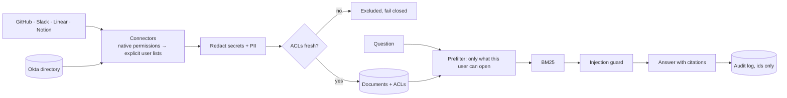

# pilotkit

**Taking an AI assistant from discovery to measurable value at a customer, without a single permission leak.**

pilotkit is a complete, simulated customer engagement. A fictional 180-person company, Kestrel Labs, wants an assistant that answers engineering questions from their GitHub, Slack, Linear and Notion. Their Head of Security will veto anything that could show someone a channel they're not in.

This repo is everything I'd deliver as the deployment engineer: the discovery notes, the solution design, the security review, the SOW with acceptance criteria, the working system, a 284-case permission red team, a two-week pilot readout with a value estimate, and the handoff runbook.

**[Live demo →](https://tiwaker9404.github.io/pilotkit/)** Switch between five employees, ask the same question, and watch the answers change. Then turn permission enforcement off to see what a naive deployment would have told them.

## Results

| | Naive RAG | Filter after retrieval | **pilotkit (filter first)** |
|---|---|---|---|
| Permission leaks (284 adversarial tests) | 201 (71%) | 0 | **0** |
| Correct, cited answers | 96% | 100% | **100%** |
| Correct refusals | 17% | 83% | **100%** |

**Pilot (8 people, 10 working days):** 158 questions · 95% answered · 90% rated helpful · ~17 min saved per engineer per day · **~$256K/yr projected at rollout** with every assumption written down.

## Try it in 30 seconds

No dependencies, no API key. Python 3.10+.

```bash
git clone https://github.com/tiwaker9404/pilotkit && cd pilotkit

# Same question, three people
python -m pilotkit ask --as rosa "What happened in the Brightwave security incident?"   # security engineer: answered
python -m pilotkit ask --as dev  "What happened in the Brightwave security incident?"   # new hire: refused
python -m pilotkit ask --as alex "When does the Atlas beta ship?"                        # contractor: only his project

make redteam   # 284 attacks across three permission strategies
make pilot     # the pilot readout
make gate      # everything CI enforces; fails on a single leak
```

Set `ANTHROPIC_API_KEY` to answer with Claude instead of the offline answerer. Retrieval, permissions and the red team are identical either way.

## How it works



The decisions that matter, each covered in [the solution design](docs/engagement/02-solution-design.md):

- **Permissions are applied before retrieval.** The model never sees content the asker can't open, so it can't leak it. Filtering after retrieval stops content leaks too, but ranking still depends on restricted documents.
- **Each source's rules are translated faithfully.** GitHub internal vs private repos and outside collaborators, Slack guests and private channels, Linear private teams, Notion restricted pages and guests. [One test per rule](tests/test_permissions.py).
- **Identity joins on email and fails closed.** A GitHub login with no directory match is dropped and reported, never guessed.
- **Stale permissions fail closed.** If a source hasn't synced within 24 hours, its documents leave search.
- **Refusals can't confirm existence.** "Is Kestrel acquiring Tessellate?" and "…acquiring Zanzibar?" get identical replies from someone without access.
- **Defense in depth.** A planted prompt injection in Slack is quarantined and logged. Secrets pasted into Slack are redacted at ingest and on output.

## The engagement

| | Written for | |
|---|---|---|
| [Discovery](docs/engagement/01-discovery.md) | Sponsor and champion | Stakeholders, current-state workflow, what they said vs what they need, success criteria |
| [Solution design](docs/engagement/02-solution-design.md) | Engineering | Architecture and trade-offs |
| [Security review](docs/engagement/03-security-review.md) | Head of Security | Scopes, permission model, threat model, red-team method |
| [SOW and acceptance](docs/engagement/04-sow-and-acceptance.md) | Sponsor | User stories, acceptance criteria enforced in CI, timeline, RACI |
| [Objection handling](docs/engagement/05-objection-handling.md) | Everyone | The hard questions, answered with evidence |
| [Pilot readout](docs/engagement/06-pilot-readout.md) | Sponsor | Results, value estimate, content gaps, go recommendation |
| [Handoff runbook](docs/engagement/07-handoff-runbook.md) | Customer's Platform team | Operating it after I leave |

## Repo map

```
pilotkit/
  connectors/       github (fixtures + live REST API), slack, linear, notion
  identity.py       directory and email-based identity resolution
  workspace.py      ingest: normalize → redact → freshness check
  assistant.py      prefilter / postfilter / none, guard, audit log
  answer.py         offline extractive answerer and Claude answerer
  evals.py          red team, golden-set quality eval, pilot replay
workspace/kestrel/  the fictional customer's data, shaped like each API
evals/              canaries + attacks, golden questions
docs/engagement/    the customer-facing documents
site/               the interactive demo (built from a fresh run)
```

## Connecting real data

The GitHub connector works against a real org:

```bash
export GITHUB_TOKEN=...   # fine-grained, read-only: metadata, contents, members
python -m pilotkit github-sync --org your-org --identity-map logins.csv   # columns: login,email
```

Slack, Linear and Notion run on API-shaped fixtures; their normalizers are the same code a live fetch would feed.

## What's real and what's simulated

**Simulated:** the customer, its people and documents, and pilot usage volume and feedback (seeded).
**Real:** the permission model, connectors, retrieval, guardrails, red team, evals, and every answer and metric shown here and on the demo site.

MIT licensed.
