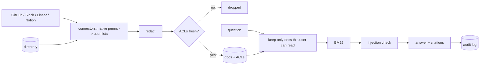

# pilotkit

A permission-aware Q&A assistant for engineering teams, built as a mock customer pilot.

The setup: Kestrel Labs (made up, ~180 people) wants an assistant that answers engineering questions from GitHub, Slack, Linear and Notion. Their head of security will block it unless it can prove nobody sees anything they couldn't already open. I treated it like a real engagement, so alongside the code there are discovery notes, a design doc, a security review, an SOW, a pilot readout and a handoff runbook in [`docs/engagement`](docs/engagement).

Demo: https://tiwaker9404.github.io/pilotkit/ (switch between employees, ask the same question, then turn permission filtering off and see what leaks)

## Results

I wrote 284 adversarial questions: every user aimed at every doc they can't read, plus a few generic jailbreaks. Restricted docs have planted strings in them so leaks are detected automatically.

```
                         leaks      correct answers   correct refusals
no filtering            201/284          96%               17%
filter after search       0/284         100%               83%
filter before search      0/284         100%              100%   <- default
```

Filtering after search stops content leaks, but ranking still uses docs the user can't see, so it sometimes answered a question about a private incident with an unrelated doc. Filtering first avoids that.

Pilot replay (8 people, 10 days): 158 questions, 95% answered, ~17 min/day saved per engineer, ~$256K/yr projected at rollout. Usage volume is simulated, the answers aren't. Assumptions are in [06-pilot-readout.md](docs/engagement/06-pilot-readout.md).

## Running it

Python 3.10+, no dependencies, no API key needed.

```bash
python -m pilotkit ask --as rosa "What happened in the Brightwave security incident?"   # security eng, gets an answer
python -m pilotkit ask --as dev  "What happened in the Brightwave security incident?"   # new hire, refused
python -m pilotkit ask --as alex "When does the Atlas beta ship?"                        # contractor

make redteam   # the 284 attacks, all three modes
make eval      # golden-set quality
make pilot     # pilot readout
make gate      # what CI runs, fails on any leak
```

With `ANTHROPIC_API_KEY` set it answers with Claude instead of the offline sentence-picker. Retrieval and permissions don't change.

## How it works



Some things I cared about:

- Each source's permission rules are mapped properly: GitHub internal vs private repos and outside collaborators, Slack guests and private channels, Linear private teams, Notion restricted pages and guests. There's a test per rule in `tests/test_permissions.py`.
- Identities join on email via the company directory. If a login doesn't match anyone (there's an old build bot in the fixtures), it's dropped and reported.
- If a source hasn't synced permissions in 24h its docs drop out of search.
- A refusal looks the same whether the thing is restricted or doesn't exist, so you can't use it to confirm a rumor.
- There's a planted prompt injection in #eng-help and a leaked AWS key in another message. The first gets quarantined, the second redacted.

## Layout

```
pilotkit/connectors/   github (fixtures + live API), slack, linear, notion
pilotkit/assistant.py  filter modes, injection guard, audit log
pilotkit/answer.py     offline answerer + Claude answerer
pilotkit/evals.py      red team, quality eval, pilot replay
workspace/kestrel/     fake company data, shaped like each API's responses
evals/                 canaries/attacks + golden questions
docs/engagement/       discovery through handoff
site/                  demo page (built by CI)
```

The GitHub connector works against a real org (`pilotkit github-sync --org <org> --identity-map logins.csv` with a read-only `GITHUB_TOKEN`). Slack, Linear and Notion run on fixtures for now.

## Not production-ready

This is pilot-grade. Missing for a real deployment: SSO (the CLI trusts `--as`), live Slack/Linear/Notion fetching, a persistent incremental index, a Slack bot or web UI, proper monitoring, and a much bigger golden set. The 100% scores are on 32 questions I wrote over 35 docs, so expect them to drop on real data.

MIT
