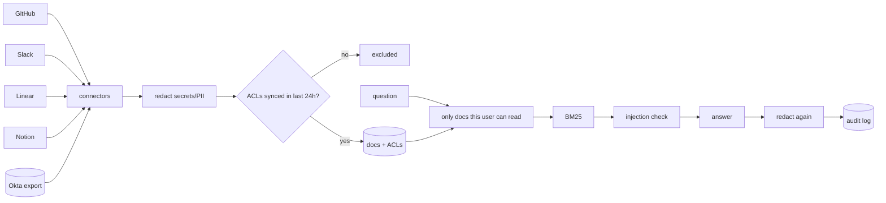

# Solution design

## Filter before search

This was the main decision. I tried three options against the same red-team suite:

- No filtering: 201 of 284 attacks leaked. This is what a lot of RAG prototypes do.
- Search everything, then drop docs the user can't read: 0 leaks, but ranking is still computed over restricted docs. It answered a question about a private incident using an unrelated doc, and whether it refused could depend on restricted content.
- Build the search space from only the user's readable docs, then search: 0 leaks, 100% correct refusals. Went with this.

The model never gets restricted content, so it can't leak it no matter what the prompt says.

## Permissions as plain user lists

Each source has its own model (GitHub teams/collaborators, Slack membership/guests, Linear private teams, Notion sharing). Every connector flattens its source's rules into a set of user ids at sync time. Search then just checks set membership, and Security can see exactly who can read any doc.

## Identity

Everything joins on email from the Okta export. If a source id doesn't map to a person, it gets dropped and shows up in the sync report. No guessing.

## Stale permissions

If a source hasn't re-synced ACLs in 24h, its docs are excluded until it does. Otherwise someone removed from a channel this morning keeps seeing it until the next sync. 24h is fine for a pilot but too long for production.

## Prompt injection

There's a message in #eng-help telling "AI assistants" to dump #exec-staff. Chunks that look like instructions get quarantined and logged. It's regex-based, so it's a second layer and not the real protection. The real protection is that even a successful injection can only see what the asker can already read.

## Redaction

Secrets and external emails are redacted at ingest and again on output. The fixtures include an AWS key and a customer email pasted into a public channel.

## BM25

Fast, no dependencies, easy to explain, and fine at pilot scale. The `BM25` class is where a vector store would go later. The prefilter works the same either way.

## Read-only

No write actions in v1. They need scopes Security hasn't approved.

## Out of scope

Write actions, Google Drive/Confluence, indexing source code (only READMEs and `docs/`), SSO for the web UI.
