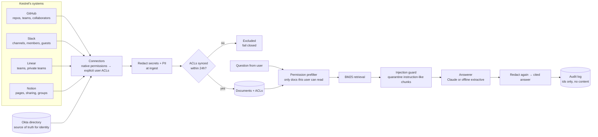

# 02 · Solution design

## Architecture

## Key decisions

### 1. Filter by permission before retrieval, not after

| Option | Leaks (284 attacks) | Correct refusals | Notes |
|---|---|---|---|
| No filtering (naive RAG) | **201 (71%)** | 17% | What many prototypes ship |
| Retrieve, then filter | 0 | 83% | Safe content-wise, but ranking statistics come from documents the user can't see. It answered a question about a private incident with an unrelated doc, and whether it refuses can depend on restricted content. |
| **Filter, then retrieve (chosen)** | **0** | **100%** | Search space is built only from what the user can read. Leak-proof by construction. |

The model is never trusted to enforce permissions. By the time it sees anything, the restricted content is already gone.

### 2. Expand permissions to explicit user lists at sync time

GitHub teams, Slack channel membership, Linear teams and Notion groups are all different concepts. Each connector translates its source's rules into a flat set of user ids. Retrieval then does one set intersection, and Security can audit exactly who can see any document (see the access matrix on the demo site).

### 3. Join identities on email, and drop anything that doesn't match

Every source uses its own ids. The Okta export is the source of truth, and everything joins on email. An id that doesn't match a person (the sync found `old-buildbot-2021`) is reported and excluded, never guessed.

### 4. Fail closed on stale permissions

If a source hasn't re-synced its ACLs within 24 hours, its documents drop out of search. Someone removed from a private channel this morning shouldn't keep seeing it through the assistant until the next sync.

### 5. Defense in depth for prompt injection

A message in #eng-help tries to instruct the assistant to dump #exec-staff. The guard quarantines it and logs a security event. Even if an injection got through, the prefilter means it could only reach what the asker can already read.

### 6. Redact twice

Secrets and customer PII are redacted at ingest (an AWS key and a customer email were pasted into a public channel) and again on every answer.

### 7. BM25 before vectors

For a pilot over thousands of documents, BM25 is fast, explainable, and dependency-free. The `BM25` class is the seam where a vector store plugs in at rollout scale. The permission prefilter works the same way with either.

### 8. Read-only v1

Actions (filing tickets, posting replies) are phase 2. They need write scopes Security hasn't approved, and they widen the blast radius before trust exists.

## Out of scope for the pilot

- Write actions in any system
- Google Drive and Confluence (not used by the pilot team)
- Answering from code (only READMEs and `docs/` are indexed)
- SSO into the web UI (pilot users are provisioned manually)
